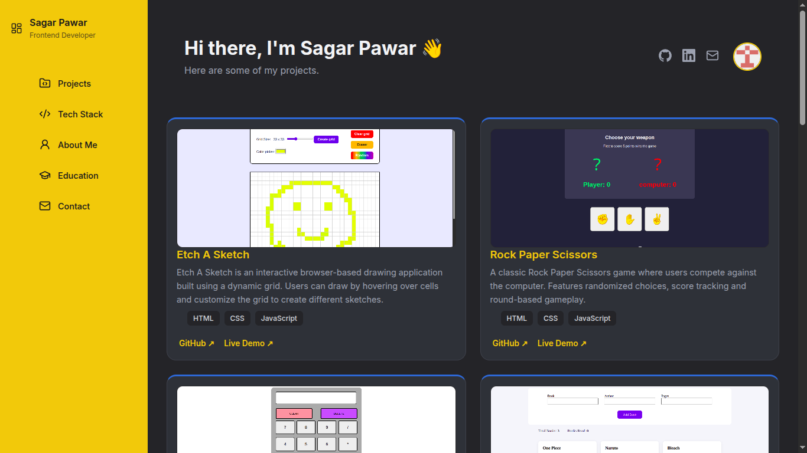
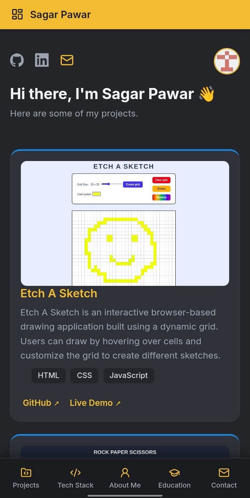

# Project Dashboard

A modern, responsive developer portfolio and project dashboard built with semantic HTML5 and vanilla CSS. Designed to showcase frontend projects, tech stack, and education with a distinct two-tone industrial aesthetic.

Built as part of **The Odin Project** curriculum.

---

## 🔗 Live Demo & Repository

* **Live Demo:** [https://project-dashboard-wheat-chi.vercel.app/](https://project-dashboard-wheat-chi.vercel.app/)
* **GitHub Repository:** [https://github.com/SagarPawar-dev/project-dashboard](https://github.com/SagarPawar-dev/project-dashboard)

---

## 📸 Preview

| Desktop View | Mobile View |
| :---: | :---: |
|  |  |


---

## ✨ Key Features

* **Custom Aesthetic:** Bold sunflower yellow sidebar paired with a warm matte charcoal canvas and electric blue accents — avoiding generic templates in favor of a clean, crafted UI.
* **Dual Responsive Layout:**
  * **Desktop:** Fixed sticky sidebar with a clean multi-column project grid.
  * **Mobile:** Transitions into a compact top header bar paired with a native-style **floating bottom navigation dock** for easy one-handed thumb navigation.
* **Interactive Project Cards:** Displays live demo links, repository links, and tech stack tags for each completed application.
* **Accessible & Semantic:** Built with semantic HTML elements (`<aside>`, `<main>`, `<article>`, `<section>`), proper `aria-labels`, and high-contrast color ratios.
* **Fast & Lightweight:** Zero external build steps, zero heavy frameworks — loads instantly with pure HTML, CSS, and lightweight Lucide icons.

---

## 🛠️ Built With

* **HTML5:** Semantic page structure and content layout.
* **CSS3:** Custom Properties (variables), CSS Grid, Flexbox, media queries for responsive layouts.
* **JavaScript:** Lightweight icon initialization.
* **Icons:** [Lucide Icons](https://lucide.dev/) & [Simple Icons](https://simpleicons.org/).
* **Deployment:** [Vercel](https://vercel.com).

---

## 📂 Featured Projects

| Project | Description | Stack | Links |
| :--- | :--- | :--- | :--- |
| **Etch A Sketch** | Interactive browser drawing pad with custom grid sizing | HTML, CSS, JS | [Live](https://sagarpawar-dev.github.io/Etch-a-sketch/) • [Repo](https://github.com/SagarPawar-dev/Etch-a-sketch) |
| **Rock Paper Scissors** | Interactive game against randomized computer choices | HTML, CSS, JS | [Live](https://sagarpawar-dev.github.io/rock-paper-scissors/) • [Repo](https://github.com/SagarPawar-dev/rock-paper-scissors) |
| **Calculator** | Arithmetic calculator with keyboard and button input support | HTML, CSS, JS | [Live](https://sagarpawar-dev.github.io/Calculator/) • [Repo](https://github.com/SagarPawar-dev/Calculator) |
| **Library** | Book tracking web app managing object data and DOM updates | HTML, CSS, JS | [Live](https://sagarpawar-dev.github.io/library/) • [Repo](https://github.com/SagarPawar-dev/library) |
| **Responsive Login Page** | Modern authentication UI with structured form layout | HTML, CSS, JS | [Live](https://sagarpawar-dev.github.io/Login-page/) • [Repo](https://github.com/SagarPawar-dev/Login-page) |
| **College Complaint Desk** | Full-stack platform for issue tracking and management | HTML, CSS, JS, Java, PostgreSQL | [Live](https://college-complaint-desk.onrender.com/) • [Repo](https://github.com/SagarPawar-dev/complaint-desk) |
| **Myntra Clone** | E-commerce front-end recreation focused on product UI | HTML, CSS, JS | [Live](https://sagarpawar-dev.github.io/Myntra-clone/) • [Repo](https://github.com/SagarPawar-dev/Myntra-clone) |
| **Weather App** | Real-time weather search with API integration | JavaScript, APIs | *In Active Development* |

---

## 🚀 Local Setup

1. **Clone the repository:**
   ```bash
   git clone https://github.com/SagarPawar-dev/project-dashboard.git
   ```

2. **Navigate into the project directory:**
   ```bash
   cd project-dashboard
   ```

3. **Open the project:**
   * Open `index.html` in your favorite browser, or
   * Use VS Code's **Live Server** extension to launch locally.

---

## 👤 Author

**Sagar Pawar**
* GitHub: [@SagarPawar-dev](https://github.com/SagarPawar-dev)
* LinkedIn: [sagar-pawar-dev](https://linkedin.com/in/sagar-pawar-dev)
* Email: [sagarpawar3546@gmail.com](mailto:sagarpawar3546@gmail.com)

---

## 📄 Acknowledgments

* [The Odin Project](https://www.theodinproject.com/) for the project specification and curriculum.

